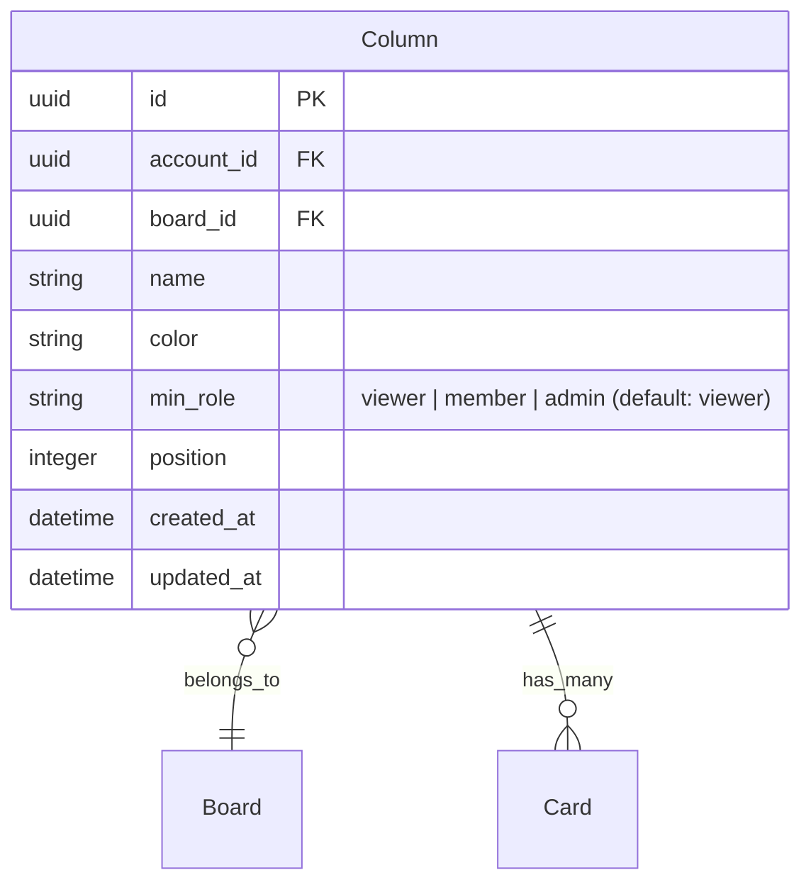

# Per-Column Role-Based Access

## Overview

Replace the binary `hidden_from_viewers` boolean on columns with a role threshold (`min_role`). Board admins can set the minimum role required to access each column: `viewer` (everyone), `member`, or `admin`. Users with a role weaker than the column's threshold cannot see the column or any of its resources.

Role hierarchy: `viewer < member < admin = owner`

## Problem Statement / Motivation

The current `hidden_from_viewers` flag only distinguishes between viewers and contributors. There's no way to hide columns from members (e.g., a "Leadership" column visible only to admins/owners). Extending column visibility to the full role hierarchy gives board admins finer-grained control over who sees what.

## Proposed Solution

Replace `hidden_from_viewers` (boolean) with `min_role` (string enum, default: `"viewer"`). Update all 6 defense layers to compare the user's role against the column's `min_role` threshold.

## Technical Approach

### Role Comparison

Add a `ROLE_LEVELS` constant to `User::Role` mapping roles to ordinal values for comparison:

```ruby
# app/models/user/role.rb
ROLE_LEVELS = { viewer: 0, member: 1, admin: 2, owner: 2 }.freeze

def role_level
  ROLE_LEVELS.fetch(role.to_sym)
end
```

Add a `Column#accessible_by?` method and scope:

```ruby
# app/models/column.rb
MIN_ROLES = %w[ viewer member admin ].freeze

scope :visible_to, ->(user) {
  if user&.admin?
    all
  elsif user&.member?
    where(min_role: %w[viewer member])
  elsif user&.viewer?
    where(min_role: "viewer")
  else
    where(min_role: "viewer")
  end
}

scope :publicly_visible, -> { where(min_role: "viewer") }
```

### Schema Change

Single migration to replace `hidden_from_viewers` with `min_role`:

```ruby
# db/migrate/XXXXX_replace_hidden_from_viewers_with_min_role.rb
class ReplaceHiddenFromViewersWithMinRole < ActiveRecord::Migration[8.2]
  def change
    add_column :columns, :min_role, :string, default: "viewer", null: false

    reversible do |dir|
      dir.up do
        Column.where(hidden_from_viewers: true).update_all(min_role: "member")
      end
      dir.down do
        Column.where.not(min_role: "viewer").update_all(hidden_from_viewers: true)
      end
    end

    remove_column :columns, :hidden_from_viewers, :boolean, default: false, null: false
  end
end
```

### Files to Change (Complete Inventory)

#### Model Layer

1. **`app/models/column.rb`** — Replace `visible_to` and `viewer_visible` scopes with role-aware versions. Add `MIN_ROLES` constant and validation. Rename `viewer_visible` to `publicly_visible`.

2. **`app/models/user/role.rb`** — Add `ROLE_LEVELS` constant and `role_level` method.

3. **`app/models/user/accessor.rb`** — Update `accessible_columns` and `accessible_cards` to use role-level comparison instead of `contributor?`/`hidden_from_viewers` check.

4. **`app/models/card.rb`** — Update `visible_to(user)` scope to exclude cards in columns where `min_role` exceeds the user's role.

5. **`app/models/search/record.rb`** — Update `for_query` to filter by role level instead of `contributor?` check.

6. **`app/models/user/day_timeline.rb`** — Update `timelineable_events` to filter by role level instead of `contributor?` check.

#### Controller Layer

7. **`app/controllers/boards/columns_controller.rb`** — Update `column_params` to permit `min_role` instead of `hidden_from_viewers`. Gate `min_role` changes to board admins via `ensure_permission_to_admin_board`.

8. **`app/controllers/cards/columns_controller.rb`** — Filter column selector with `visible_to(Current.user)` so members don't see admin-only columns when triaging.

9. **`app/controllers/public/base_controller.rb`** — Replace `hidden_from_viewers?` check with `min_role != "viewer"` (or use `publicly_visible` scope).

#### View Layer

10. **`app/views/boards/show/menu/_column_form.html.erb`** — Replace checkbox with a `<select>` dropdown for `min_role` (viewer/member/admin). Only show when user can administer the board.

11. **`app/views/boards/show/_column.html.erb`** — Update the hidden indicator to show role threshold (e.g., "Members+" or "Admins only" badge) instead of a generic eye-off icon.

12. **`app/views/public/boards/show/_columns.html.erb`** — Replace `viewer_visible` with `publicly_visible`.

13. **`app/views/cards/display/preview/_columns.html.erb`** — Apply `visible_to(Current.user)`.

14. **`app/views/cards/display/public_preview/_columns.html.erb`** — Replace `viewer_visible` with `publicly_visible`.

#### Export/Import

15. **`app/models/account/data_transfer/record_set.rb`** — Add import compatibility: map `hidden_from_viewers: true` to `min_role: "member"` and `hidden_from_viewers: false` to `min_role: "viewer"` when importing older exports.

#### Tests

16. **`test/models/column/viewer_visibility_test.rb`** — Rename to `role_visibility_test.rb`. Add tests for all role/min_role combinations.

17. **`test/models/user/accessor_column_visibility_test.rb`** — Extend with member + admin-only column scenarios.

18. **`test/controllers/boards/column_visibility_test.rb`** — Extend with member access tests and admin-only column scenarios.

19. **`test/controllers/public/column_visibility_test.rb`** — Update to use `min_role` instead of `hidden_from_viewers`.

20. **`test/controllers/viewer_authorization_test.rb`** — Add member authorization tests for admin-only columns.

## Acceptance Criteria

- [ ] Column has a `min_role` attribute (string, default: `"viewer"`, values: `viewer`/`member`/`admin`)
- [ ] `hidden_from_viewers` column is removed
- [ ] Board admins can set `min_role` per column via a dropdown in the column form
- [ ] Viewers cannot see columns with `min_role` > `viewer`
- [ ] Members cannot see columns with `min_role` = `admin`
- [ ] Admins and owners see all columns regardless of `min_role`
- [ ] Cards in restricted columns are invisible to excluded roles across: board view, closed cards, search, timeline, filters, direct URL access
- [ ] Triage card column picker is filtered by `visible_to(Current.user)`
- [ ] Public boards only show columns with `min_role` = `viewer`
- [ ] Existing `hidden_from_viewers: true` data migrates to `min_role: "member"`
- [ ] Import handles both old (`hidden_from_viewers`) and new (`min_role`) formats

## Open Questions

**Q1: Notifications** — Should users receive notifications about activity in columns they can't see? Currently notifications are not filtered by column visibility. Options:
  - (a) Filter notifications — prevents information leaks but adds query per notification
  - (b) Leave unfiltered — simpler, link would 404 but title is visible

**Q2: Cleanup on min_role raise** — When a column's `min_role` is raised, should existing assignments/watches/pins from now-excluded users be cleaned up?
  - (a) Async cleanup job (mirrors `Board::CleanInaccessibleDataJob` pattern)
  - (b) No cleanup — stale data is filtered out at query time, persists in DB

**Q3: Webhooks** — Should webhooks fire for events in restricted columns? Webhooks are admin-configured system integrations, so likely yes, but worth confirming.

## ERD Changes



## References

- Current implementation: `app/models/column.rb:8-16` (visible_to scope)
- Role definitions: `app/models/user/role.rb`
- Accessor overrides: `app/models/user/accessor.rb:14-28`
- Documented bypass: `docs/solutions/authorization/closed-cards-column-visibility-bypass.md`
- Prior plans: `docs/plans/2026-02-21-feat-selective-column-visibility-for-viewers-plan.md`, `docs/plans/2026-02-20-feat-add-viewer-role-plan.md`
