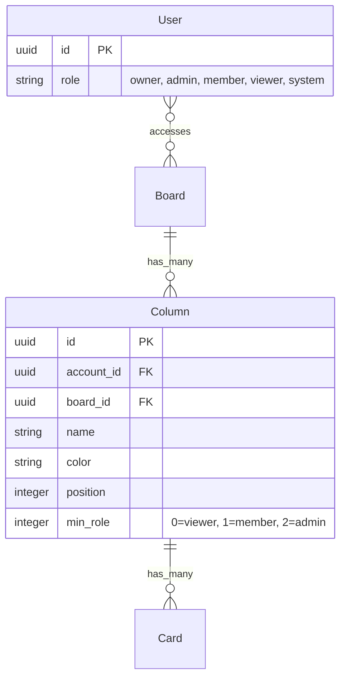

# Per-Column Role-Based Access

## Overview

Extend the existing per-column viewer restriction to a full role-based access system. Board admins can set a minimum role (`viewer`, `member`, `admin`) per column. Users with a weaker role than the column's threshold cannot see the column or any of its cards.

Currently, columns have a `viewer_restricted` boolean that only affects viewers. This replaces that with a `min_role` enum supporting the full role hierarchy: `viewer < member < admin = owner`.

## Problem Statement / Motivation

The current binary viewer-restricted toggle is too coarse. Teams need to restrict sensitive columns (e.g., "Security Issues", "HR Reviews") from members too, not just viewers. The role hierarchy already exists — the column access system just needs to use it.

## Proposed Solution

Replace `viewer_restricted` boolean with a `min_role` string column. Extract shared filtering scopes to eliminate the current 5+ location duplication. Update all enforcement points to use role-rank comparison instead of boolean checks.

### Role Hierarchy

```
viewer(0) < member(1) < admin(2)
owner maps to admin(2)
system maps to admin(2)
```

### Column `min_role` Values

| Value | Who can see | Label in UI |
|-------|------------|-------------|
| `viewer` (default) | Everyone | Everyone |
| `member` | Members, admins, owners | Members & admins |
| `admin` | Admins and owners only | Admins only |

## Technical Approach

### Phase 1: Extract shared scopes (preparatory refactoring)

Before changing the data model, consolidate the duplicated filtering pattern into reusable scopes. This reduces the risk surface of Phase 2 to a single-point change.

**`app/models/column/accessible.rb`** — new concern:

```ruby
module Column::Accessible
  extend ActiveSupport::Concern

  ROLE_RANKS = { "viewer" => 0, "member" => 1, "admin" => 2 }.freeze

  included do
    scope :accessible_by, ->(user) {
      return all if user.admin?
      where("columns.min_role <= ?", ROLE_RANKS.fetch(user.role, 0))
    }
  end

  def accessible_to?(user)
    user.admin? || ROLE_RANKS.fetch(min_role, 0) <= ROLE_RANKS.fetch(user.role, 0)
  end
end
```

**`app/models/card/column_accessible.rb`** — shared card filtering scope:

```ruby
module Card::ColumnAccessible
  extend ActiveSupport::Concern

  included do
    scope :column_accessible_by, ->(user) {
      return all if user.admin?

      rank = Column::Accessible::ROLE_RANKS.fetch(user.role, 0)
      left_joins(:column)
        .where("columns.min_role IS NULL OR columns.min_role <= ?", rank)
    }
  end
end
```

**Replace all 5+ duplicated filtering locations** with calls to these scopes:

1. `CardPolicy#relation_scope` (`app/policies/card_policy.rb:9-12`)
2. `Filter#cards` (`app/models/filter.rb:22-25`)
3. `Search::Record.for_query` (`app/models/search/record.rb:30-33`)
4. `Prompts::CardsController#published_cards` (`app/controllers/prompts/cards_controller.rb:31-38`)
5. `User::DataExport#exportable_cards` (`app/models/user/data_export.rb:20-27`)

Also replace:
6. `Boards::ColumnsController#index` manual filter (`app/controllers/boards/columns_controller.rb:8`)
7. Public board column queries (`app/views/public/boards/show/_columns.html.erb:17`, `app/controllers/public/boards/columns_controller.rb:14`)

### Phase 2: Data model migration

**Migration**: Add `min_role` column, backfill from `viewer_restricted`, remove old column.

```ruby
# db/migrate/XXXXXX_replace_viewer_restricted_with_min_role.rb
class ReplaceViewerRestrictedWithMinRole < ActiveRecord::Migration[8.0]
  def up
    add_column :columns, :min_role, :integer, default: 0, null: false

    Column.where(viewer_restricted: true).update_all(min_role: 1) # member

    remove_column :columns, :viewer_restricted
  end

  def down
    add_column :columns, :viewer_restricted, :boolean, default: false, null: false

    Column.where("min_role > 0").update_all(viewer_restricted: true)

    remove_column :columns, :min_role
  end
end
```

**Column model enum**:

```ruby
# app/models/column.rb
class Column < ApplicationRecord
  include Accessible, Colored, Positioned

  enum :min_role, { viewer: 0, member: 1, admin: 2 }, default: :viewer
  # ...
end
```

Using integer enum (not string) for the `<=` comparison in SQL scopes. This makes `accessible_by` a simple integer comparison.

### Phase 3: Update policies

**`app/policies/column_policy.rb`**:

```ruby
def show?
  if record.accessible_to?(user)
    allowed_to?(:show?, record.board)
  else
    false
  end
end
```

**`app/policies/card_policy.rb`**:

```ruby
def show?
  if record.column && !record.column.accessible_to?(user)
    false
  else
    allowed_to?(:show?, record.board)
  end
end

# relation_scope uses Card.column_accessible_by(user) instead of inline viewer check
```

**`app/policies/application_policy.rb`** — remove `not_viewer?`, replace with `not_restricted?` or keep `not_viewer?` for create operations (viewers still cannot create). Actually, `not_viewer?` is still correct for create/manage operations — it's the column visibility that changes, not the "can this role write" question.

### Phase 4: Guard card movement targets

Add authorization on the target column for card movement operations:

**`app/controllers/cards/triages_controller.rb`**:

```ruby
def create
  column = @card.board.columns.find(params[:column_id])
  authorize! column, to: :show?
  @card.triage_into(column)
end
```

**`app/controllers/columns/cards/drops/columns_controller.rb`**:

```ruby
def create
  authorize! @column, to: :show?  # target column
  # ... existing drop logic
end
```

**`app/controllers/cards/columns_controller.rb`** — filter column list in edit:

```ruby
def edit
  @columns = @card.board.columns.sorted.select { |c| allowed_to?(:show?, c) }
end
```

### Phase 5: Pseudo-column filtering

**Closed panel** (`app/controllers/boards/columns/closeds_controller.rb`):

```ruby
def show
  cards = @board.cards.closed.column_accessible_by(Current.user)
  set_page_and_extract_portion_from cards.recently_closed_first.preloaded
end
```

**Not Now panel**: Cards here have `column_id: nil`, so they pass the scope filter. Accept as known behavior — postponed cards are visible to all board members regardless of their original column. Document as intentional.

### Phase 6: Update UI

**Column menu dropdown** (`app/views/boards/show/menu/_column.html.erb`):

Replace the toggle button (lines 36-44) with a select dropdown:

```erb
<%= form_with url: board_column_path(column.board, column),
              method: :patch, class: "display-contents" do |f| %>
  <div class="popup__field">
    <%= f.select :min_role,
        options_for_select(
          [["Everyone", "viewer"], ["Members & admins", "member"], ["Admins only", "admin"]],
          column.min_role
        ),
        {},
        { class: "select", onchange: "this.form.requestSubmit()" } %>
  </div>
<% end %>
```

**Column visual indicator**: Show a lock/shield icon on restricted columns (for admins who can see the restriction level).

**Column params** (`app/controllers/boards/columns_controller.rb:54`):

```ruby
def column_params
  params.expect(column: [ :name, :color, :min_role ])
end
```

### Phase 7: Update tests

**Fixtures** (`test/fixtures/columns.yml`): Add `min_role: member` to one column, `min_role: admin` to another for testing.

**Policy tests**:
- `ColumnPolicyTest`: Test show? for each role × each min_role combination
- `CardPolicyTest`: Test show? and relation_scope for member-restricted and admin-restricted columns
- `CommentPolicyTest`: Verify cascade from card policy

**Controller tests**:
- Boards::ColumnsController: Verify index filtering for members viewing admin-only columns
- Cards::TriagesController: Verify member cannot triage into admin-only column
- Cards::ColumnsController: Verify column list filtered by access
- Boards::Columns::ClosedsController: Verify closed cards filtered by column access

**Integration points**:
- Search: member cannot find cards in admin-only columns
- Filter: member filter excludes admin-only column cards
- Data export: member export excludes admin-only column cards
- Autocomplete: member autocomplete excludes admin-only column cards

## Key Decisions

### Board creator override

A member who created a board is a "board admin" per `BoardPolicy#board_admin?`. Column access should respect this — if `allowed_to?(:manage?, record.board)` is true, the user can see any column on that board. Update `ColumnPolicy#show?`:

```ruby
def show?
  allowed_to?(:manage?, record.board) || record.accessible_to?(user)
    ? allowed_to?(:show?, record.board)
    : false
end
```

### Public boards

Public boards have no authenticated user. All columns with `min_role > viewer` should be hidden. The `accessible_by` scope handles this — public views use `Column.where(min_role: :viewer)` (equivalent to the current `where(viewer_restricted: false)`).

### Turbo broadcasts

Board-level broadcasts trigger server-side re-renders with policy checks — safe. Card-level stream subscriptions persist if a user is viewing a card when its column restriction changes. Accept for MVP — the user sees stale data until they navigate away.

### Notifications and timeline

Accept current behavior for MVP: notifications and timeline events are not filtered by column access. Track as post-MVP improvement. The notification volume impact is larger now (members > viewers), so this should be prioritized after launch.

## System-Wide Impact

- **Interaction graph**: Column update triggers `board.touch` (via `belongs_to :board, touch: true`), which triggers board broadcasts. Card visibility cascades through `CardScoped` concern to all card subresources.
- **Error propagation**: 404 for `show?` failures (existing pattern via `Authorization#handle_unauthorized`). No new error paths.
- **State lifecycle risks**: Postponed cards lose column_id, escaping column restrictions. Closed cards retain column_id and need filtering.
- **API surface parity**: Column JSON responses, webhook payloads, and data exports all need `min_role` awareness.

## Acceptance Criteria

- [x] Column has `min_role` enum (viewer/member/admin) replacing `viewer_restricted` boolean
- [x] Board admins can set column min_role via dropdown in column menu
- [x] Users with role below column's min_role cannot see the column
- [x] Cards in restricted columns are hidden from unauthorized users (views, search, filters, exports, autocomplete)
- [x] Members cannot triage/drag cards into columns they cannot see
- [x] Closed panel respects column access
- [x] Board creators (even if member-role) can see all columns on their boards
- [x] Public boards hide all non-viewer columns
- [ ] Existing `viewer_restricted: true` columns migrate to `min_role: member` (post-deploy data migration)
- [x] Policy tests cover all role × min_role combinations
- [x] Controller tests verify filtering at each enforcement point

## MVP File Changes

| File | Change |
|------|--------|
| `db/migrate/XXXX_replace_viewer_restricted_with_min_role.rb` | New migration |
| `app/models/column.rb` | Add enum, include Accessible |
| `app/models/column/accessible.rb` | New concern with scope and predicate |
| `app/models/card/column_accessible.rb` | New concern with shared filtering scope |
| `app/models/card.rb` | Include ColumnAccessible |
| `app/policies/column_policy.rb` | Generalize show? to role comparison |
| `app/policies/card_policy.rb` | Generalize show? and relation_scope |
| `app/policies/application_policy.rb` | Keep not_viewer? for create operations |
| `app/models/filter.rb` | Use shared scope |
| `app/models/search/record.rb` | Use shared scope |
| `app/models/user/data_export.rb` | Use shared scope |
| `app/controllers/boards/columns_controller.rb` | Use scope in index, update params |
| `app/controllers/cards/triages_controller.rb` | Add target column authorization |
| `app/controllers/columns/cards/drops/columns_controller.rb` | Add target column authorization |
| `app/controllers/cards/columns_controller.rb` | Filter column list by access |
| `app/controllers/boards/columns/closeds_controller.rb` | Add column filtering |
| `app/controllers/prompts/cards_controller.rb` | Use shared scope |
| `app/controllers/public/boards/columns_controller.rb` | Update query |
| `app/views/boards/show/menu/_column.html.erb` | Replace toggle with dropdown |
| `app/views/public/boards/show/_columns.html.erb` | Update query |
| `test/fixtures/columns.yml` | Add min_role values |
| `test/policies/*_policy_test.rb` | Add role × min_role test matrix |
| `test/controllers/**/*_test.rb` | Add filtering tests |

## Post-MVP Improvements

- Filter notifications by column access (suppress push payloads for restricted cards)
- Filter activity timeline by column access
- Handle card-level Turbo stream cleanup on column restriction changes
- Consider `original_column_id` to maintain restrictions on postponed cards

## References

- Current implementation: commit `5fa9aefc0` (per-column viewer access)
- Security learnings: `docs/solutions/security-issues/column-viewer-restrictions-secondary-data-path-bypass.md`
- Authorization patterns: `docs/solutions/action-policy-authorization-patterns.md`
- Viewer role gaps: `docs/solutions/security-issues/authorization-gaps-viewer-role-action-policy.md`


